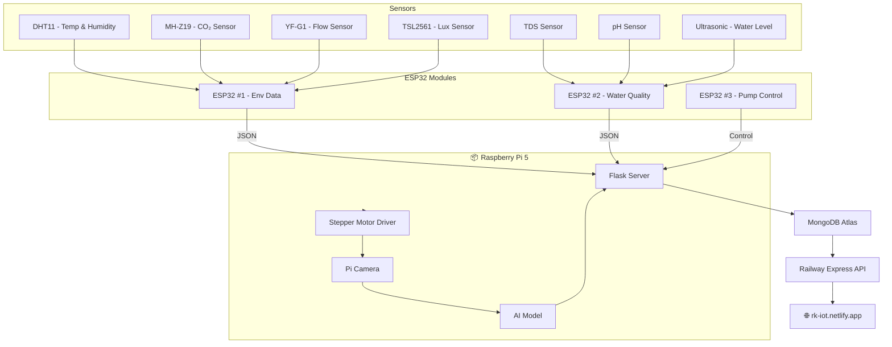

# 🌱 Smart Hydroponic Farming & AI-Based Plant Disease Detection System

A fully integrated, **solar-powered**, **AI-enhanced smart farming system** designed for sustainable agriculture. This system combines **IoT sensor networks**, **automated irrigation**, **real-time monitoring**, and **AI-based plant health detection** to maximize yield with minimal manual intervention.

---

## 🚀 Key Features

### ✅ Real-Time Environmental Monitoring

* 🌡️ **Temperature & Humidity** – DHT11 sensor on ESP32-1
* 🫁 **CO₂ Monitoring** – MH-Z19 sensor
* 💧 **Water Flow & Level** – YF-G1 Flow Sensor & HC-SR04 Ultrasonic Sensor
* 🌊 **Nutrient & pH Tracking** – TDS + Analog pH Sensor
* 🌞 **Light Intensity** – TSL2561 Sensor

### ⚙️ Sensor Network

**ESP32 #1:**

* DHT11 (Temp & Humidity)
* MH-Z19 (CO₂)
* YF-G1 (Flow Rate)
* TSL2561 (Lux)

**ESP32 #2:**

* HC-SR04 (Water Level)
* Analog TDS Sensor
* Analog pH Sensor

**ESP32 #3:**

* Dual-Relay Module (Controls Nutrient & Wastewater Pumps)

**📸 Raspberry Pi 5:**

* Aggregates all sensor data
* Controls stepper motor for Pi Camera slider
* Hosts Flask server
* Runs AI Model for Disease Detection
* Stores results and 64-bit image in MongoDB

---

## 📊 Automated Data Logging & Monitoring

* Python Flask server on Raspberry Pi fetches JSON data from ESP32s.

* MongoDB (Atlas) stores:

  * ✅ Latest Sensor Readings
  * 📈 7-Day Rolling Averages
  * 🧠 AI Predictions (Label + Confidence)
  * 📸 Base64 Camera Images

* Fields include:
  `Temperature`, `Humidity`, `CO₂`, `FlowRate`, `Lux`, `Level`, `TDS`, `pH`, `SensorStatus`, `LastUpdate`

---

## 🧠 AI-Based Plant Disease Detection

### 🔬 ML Pipeline

* **Input:** Real-time Pi Camera image
* **Preprocessing:** Resize → Normalize → Histogram Equalization
* **Model:** TensorFlow Lite CNN
* **Classes:**

  * Healthy
  * Early Blight
  * Late Blight
  * Nutrient Deficiency
* **Output:** Class + Confidence Score
* **Storage:** MongoDB (Base64 image + prediction)

---

## 🌐 System Architecture



📸 **Circuit Diagrams & Screenshots:**

| Image                                                          | Description                          |
| -------------------------------------------------------------- | ------------------------------------ |
|  | Sensor Circuit Diagram (ESP1 + ESP2) |
|           | Dashboard - Sensor View              |
|           | Dashboard - Averages Graph           |
|           | Dashboard - pH & TDS                 |
|          | Data Flow Diagram                    |
|        | Power System Diagram                 |

---

## ☀️ Solar Power System

* 🔋 **2x Loom 20W 12V Solar Panels**

  * One directly powers the system (daytime).
  * Second charges 2x 12V 6Ah Li-ion batteries via 20A Solar Charge Controller.
* 🔌 Power routed through **12V Relay System** with auto switch logic.
* Buck converters:

  * **5V 4A Converter #1** – ESP32s
  * **5V 4A Converter #2** – Raspberry Pi
* Raspberry Pi GPIO controls:

  * Pump Relay (via ESP32 #3)
  * Stepper Motor Driver (camera slider)

---

## 🧱 Tech Stack

| Component        | Stack                             |
| ---------------- | --------------------------------- |
| Microcontrollers | ESP32, NodeMCU                    |
| SBC              | Raspberry Pi 5                    |
| Languages        | Python, JavaScript, C++ (Arduino) |
| Frontend         | React.js, Chart.js                |
| Backend          | Node.js + Express.js              |
| Database         | MongoDB (Atlas Cloud)             |
| ML               | TensorFlow Lite, OpenCV           |
| Hosting          | Netlify (Frontend), Railway (API) |

---

## 🗂️ Directory Structure

```bash
Smart-Hydroponic-Farming-Plant-Disease-Detection-System/
├── client/                   # React frontend
│   ├── public/
│   └── src/
│       ├── api/
│       ├── components/
│       ├── context/
│       ├── hooks/
│       └── utils/
│
├── sensor code/             # ESP32 & NodeMCU firmware
│   └── farming/
│       ├── esp32_1.ino
│       ├── esp32_2.ino
│       └── nodemcu_relay.ino
│
├── server/                  # Node.js backend
│   ├── controllers/
│   ├── models/
│   ├── routes/
│   ├── middleware/
│   └── utils/
│
├── ml/                      # AI/ML pipeline
│   ├── model/
│   └── scripts/
│       ├── preprocess.py
│       ├── train.py
│       └── tflite_converter.py
│
├── docs/
│   ├── Smart_Hydroponic_Farming.md
│   └── API_Documentation.md
├── .gitignore
├── LICENSE
└── README.md
```

---

## ⚙️ Installation & Setup

### 🔀 Clone the Repository

```bash
git clone https://github.com/abdul-rahman-1/Smart-Hydroponic-Farming-Plant-Disease-Detection-System.git
cd Smart-Hydroponic-Farming-Plant-Disease-Detection-System
```

### 🚀 Backend Setup

```bash
cd server
cp .env.example .env
npm install
npm start
```

### 🎯 Frontend Setup

```bash
cd client
npm install
npm run dev
```

### 🧠 ML Setup (Optional)

```bash
cd ml
pip install -r requirements.txt
python scripts/train.py
```

### 📡 Microcontroller Firmware

* Open `.ino` files in Arduino IDE
* Update Wi-Fi credentials
* Upload to ESP32 or NodeMCU

---

## 🌐 Live Demo

* **Web Dashboard:** [rk-iot.netlify.app](https://rk-iot.netlify.app)
* **API Endpoint:** [rk-server.up.railway.app/api/data](https://rk-server.up.railway.app/api/data)

---

## 📄 License

MIT License. See [LICENSE](./LICENSE) for details.

---

## 🙌 Acknowledgments

Special thanks to open-source contributors and community mentors.

---

> 🌿 Empowering agriculture with smart IoT and edge AI. Let plants speak, we listen. 🌿
